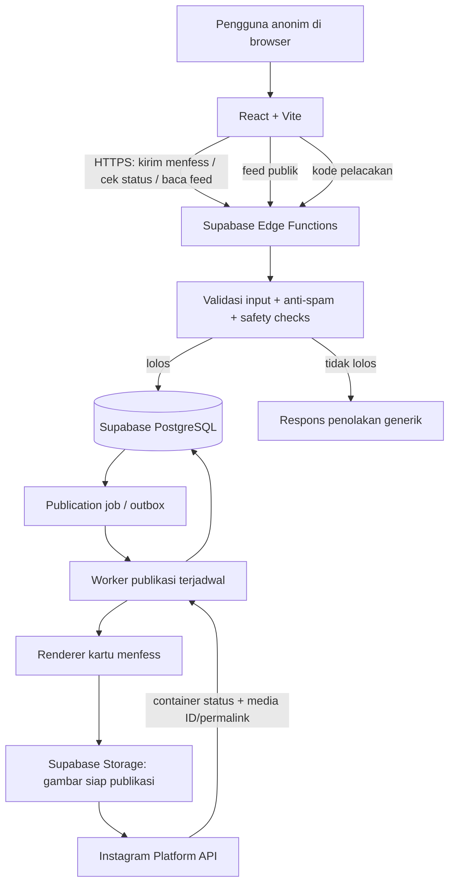
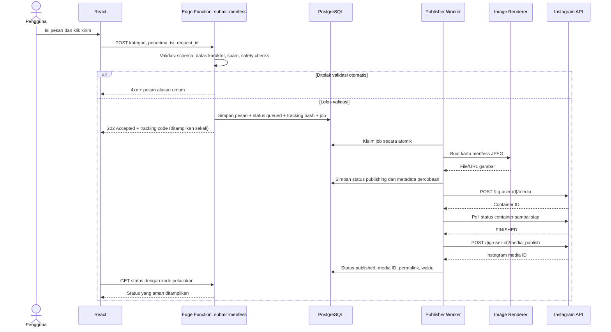

# Arsitektur Menfess Spenthree

**Status dokumen:** Draft arsitektur MVP  
**Stack utama:** React JS + Vite, Supabase, Instagram Platform API  
**Prinsip produk:** anonim, tanpa login pengguna, tanpa panel admin/moderator di website, publikasi Instagram otomatis setelah validasi sistem.

---

## 1. Ringkasan keputusan

1. Website tidak menyediakan login pengguna maupun panel admin/moderator.
2. Pengguna menulis pesan, melihat pratinjau, lalu mengirim menfess secara anonim.
3. Setelah pengiriman, backend menjalankan validasi otomatis dan anti-spam. Tidak ada persetujuan manusia sebelum publikasi.
4. Pesan yang lolos validasi masuk antrean publikasi otomatis ke Instagram.
5. Teks menfess dibuat menjadi gambar postingan dengan template visual yang konsisten.
6. Pengguna menerima kode pelacakan acak untuk memeriksa status kirim/publikasi.
7. Beranda website hanya menampilkan pesan dengan status `published`.
8. Rahasia Meta/Instagram, Supabase secret key, dan akses operasional hanya berada di sisi server/infrastruktur.
9. Fitur tanggapan OSIS ditunda dari MVP karena tidak ada alur staf di dalam website untuk menyusun dan menerbitkan tanggapan.

**Makna anonim:** website tidak meminta nama atau akun pengirim dan tidak menampilkan identitas pengirim. Ini bukan jaminan bahwa seluruh penyedia infrastruktur tidak menyimpan metadata teknis. Kebijakan privasi harus menjelaskan data apa yang disimpan dan berapa lama.

## 2. Diagram arsitektur



### Komponen dan tanggung jawab

| Komponen | Tanggung jawab |
|---|---|
| React + Vite | UI Beranda, Tulis, Periksa, Status, Detail, Panduan; validasi awal; state loading/error. |
| Supabase Edge Functions | Endpoint publik; validasi server-side; rate limit; menghasilkan kode pelacakan; membatasi data yang dapat dibaca; integrasi eksternal. |
| PostgreSQL | Menyimpan isi menfess, status publikasi, kode pelacakan dalam bentuk hash, job publikasi, dan metadata Instagram. |
| Publication queue/worker | Memproses pekerjaan asinkron, mencatat percobaan, menjadwalkan ulang kegagalan yang aman, dan mencegah duplikasi. |
| Renderer | Membuat gambar JPEG dari teks/kategori/penerima dengan template merek Menfess Spenthree. Implementasi harus diuji terpisah sebelum memilih runtime/library final. |
| Supabase Storage | Menyimpan aset final yang memang akan dipublikasikan. URL harus dapat diambil Instagram saat publikasi. Jangan simpan data sensitif pada nama file/URL. |
| Instagram Platform API | Membuat media container, memeriksa status container, dan menerbitkan media ke akun tujuan. |
| Vercel (opsional/rekomendasi) | Hosting frontend React. Jika renderer ditempatkan di Vercel Function, gunakan endpoint server-side yang hanya dapat dipanggil backend. |

## 3. Batas fitur MVP

### Masuk MVP

- Beranda: menfess terbit, filter kategori, urutan terbaru, jumlah suka jika anti-spam siap.
- Tulis menfess: kategori, penerima opsional, isi pesan, persetujuan aturan.
- Pratinjau sebelum pengiriman.
- Pengiriman anonim tanpa akun.
- Validasi otomatis dan perlindungan spam.
- Generator gambar Instagram.
- Publikasi Instagram otomatis.
- Status dan kode pelacakan.
- Detail menfess yang sudah terbit.
- Panduan dan kebijakan privasi.
- Logging operasional terbatas dan mekanisme retry.

### Di luar MVP

- Panel admin/moderator pada website.
- Login pengguna/pembuatan profil pengirim.
- Persetujuan manual sebelum publikasi.
- Tanggapan OSIS yang dibuat dari website.
- Komentar antar-pengguna, DM, unggah gambar oleh pengirim, dan notifikasi push.
- Jaminan bahwa filter otomatis selalu dapat menemukan semua konten berbahaya.

Jika tanggapan OSIS dibutuhkan kelak, harus diputuskan alurnya secara terpisah; saat ini tidak ada antarmuka staf untuk membuat tanggapan.

## 4. Alur pengiriman dan publikasi



### Status pesan

Gunakan status terpisah dari detail error internal:

- `queued`: lolos validasi dan menunggu worker.
- `processing`: sedang dibuat gambarnya/diproses.
- `publishing`: media sedang diproses oleh Instagram.
- `published`: Instagram mengonfirmasi publikasi.
- `retry_scheduled`: kegagalan sementara yang aman untuk dicoba ulang.
- `failed`: publikasi gagal setelah retry yang diizinkan atau butuh pemeriksaan operasional.
- `blocked`: gagal melewati validasi otomatis sebelum publikasi.

Beranda hanya query data `published`. Kegagalan publikasi jangan membuat postingan baru secara membabi buta: bila respons API ambigu, rekonsiliasi status terlebih dahulu untuk menghindari duplikasi.

## 5. Kontrak API aplikasi

Endpoint berikut berjalan di sisi server melalui Supabase Edge Functions. Nama di bawah adalah usulan untuk menyepakati kontrak.

| Method | Endpoint | Tujuan |
|---|---|---|
| `POST` | `/functions/v1/submit-menfess` | Validasi dan menyimpan pesan; membuat tracking code; memasukkan job ke antrean. |
| `GET` | `/functions/v1/public-feed?category=...&cursor=...` | Mengembalikan pesan `published` saja, dengan pagination. |
| `POST` | `/functions/v1/track-menfess` | Mencari status menggunakan kode pelacakan; respons hanya berisi field yang aman. POST dipakai supaya kode tidak masuk URL/log browser. |
| `GET` | `/functions/v1/public-menfess?id=...` | Detail pesan `published` saja. |
| `POST` | `/functions/v1/like-menfess` | Opsional: suka dengan kontrol anti-abuse; tunda bila tidak dapat membatasi spam dengan baik. |
| internal/cron | `process-publication-queue` | Mengklaim dan mengerjakan job publikasi; tidak boleh bisa dipanggil sembarang orang tanpa pengamanan. |
| internal | `instagram-webhook` (jika diperlukan) | Endpoint untuk event webhook Meta, dengan verifikasi tanda tangan/token sesuai protokol Meta. |

`submit-menfess` harus merespons cepat setelah job disimpan, tidak perlu menunggu publikasi Instagram selesai. Frontend menampilkan “Menfess diterima, sedang dipublikasikan” dan melakukan polling status secara terbatas. Ini memberi UX lebih baik dan menjaga proses API eksternal terpisah dari request pengguna.

## 6. Model database awal

### `messages`

| Kolom | Tipe / aturan | Keterangan |
|---|---|---|
| `id` | `uuid` primary key | ID internal, bukan kode tracking publik. |
| `tracking_code_hash` | `text` unique not null | Hash dari kode pelacakan acak; kode asli hanya ditampilkan ke pengirim saat submit berhasil. |
| `category` | enum/check | `menfess`, `aspirasi`, `curhat`, `apresiasi`. |
| `recipient` | `text` nullable | Penerima opsional; batasi panjang dan karakter kontrol. |
| `content` | `text` not null | Isi pesan, batas produk awal 10–500 karakter. |
| `status` | enum/check | Salah satu status publikasi yang didefinisikan di atas. |
| `created_at` | `timestamptz` | Waktu kirim. |
| `published_at` | `timestamptz` nullable | Waktu publikasi berhasil. |
| `ig_media_id` | `text` nullable unique | ID media yang dikembalikan Instagram. |
| `ig_permalink` | `text` nullable | URL postingan jika dapat diperoleh. |
| `rendered_image_path` | `text` nullable | Path aset kartu yang telah dirender. |
| `request_id` | `uuid` unique | Idempotency key untuk satu pengiriman dari klien. |
| `expires_at` | `timestamptz` nullable | Bahan untuk retensi/penghapusan otomatis sesuai kebijakan. |

**Penting:** tabel ini tidak boleh diekspos bebas ke browser. Feed dan tracking dibaca melalui endpoint/RPC yang memilih kolom tertentu. Kebijakan RLS dan SQL grants harus diuji, bukan hanya diasumsikan aman.

### `publication_jobs`

Kolom awal: `id`, `message_id` (unique untuk job publikasi utama), `status`, `attempt_count`, `next_attempt_at`, `locked_at`, `last_error_code`, `created_at`, `updated_at`.

- Job diklaim secara atomik oleh worker agar dua worker tidak mengerjakan pesan yang sama.
- Simpan error ringkas berbentuk kode, bukan access token, payload sensitif, atau seluruh respons API.
- Retry dengan backoff eksponensial dan batas percobaan.
- Jika hasil publikasi ambigu, jangan langsung ulangi `media_publish`; lakukan rekonsiliasi terlebih dahulu.

### `message_likes` (opsional)

Kolom awal: `id`, `message_id`, `voter_token_hash`, `created_at`, dengan constraint unik `(message_id, voter_token_hash)`. Karena pengunjung anonim dapat menghapus cookie atau berpindah perangkat, fitur suka tetap rentan manipulasi; jadikan P1, bukan ketergantungan MVP.

### Kebijakan penyimpanan

Tentukan retensi untuk isi yang diblokir, data job yang gagal, dan log. Hindari menyimpan IP mentah atau fingerprint permanen tanpa kebutuhan jelas. Bila rate limiting memerlukan pengenal request, gunakan mekanisme berumur pendek/ter-hash dengan secret dan jelaskan pengolahan datanya pada kebijakan privasi.

## 7. Keamanan dan privasi

### Endpoint pengiriman publik

Karena tidak ada login, endpoint submit adalah endpoint publik dan harus dianggap dapat diserang. Minimal:

1. Validasi ulang di server: kategori allowlist, 10–500 karakter, panjang penerima, encoding, dan payload size.
2. Rate limiting per kombinasi yang wajar (token tantangan, jendela waktu, sinyal request); jangan mengandalkan IP saja.
3. Pertimbangkan Cloudflare Turnstile atau challenge sejenis jika spam menjadi masalah.
4. Terapkan batas concurrency dan backpressure untuk antrean.
5. Gunakan `request_id`/idempotency untuk mencegah refresh/double click membuat dua job.
6. Batasi safety checks: larangan ancaman, doxxing/data pribadi, pelecehan yang ditargetkan, spam, dan konten yang tidak sesuai. Filter otomatis tidak sempurna; tampilkan aturan yang jelas dan sediakan jalur laporan/penghapusan di luar panel web.
7. Jangan percaya field `status`, `ig_media_id`, `published_at`, atau `tracking_code_hash` dari klien.

### Database dan secrets

- Aktifkan RLS pada semua tabel di schema yang terekspos dan atur SQL grants minimum.
- Berikan akses baca publik hanya melalui view/RPC/Edge Function yang benar-benar membatasi pesan `published` serta kolom yang dikembalikan.
- `service_role`/secret key dan Instagram access token hanya sebagai secrets di server. Jangan masukkan ke `VITE_*`, frontend bundle, screenshot, README, atau Git.
- CORS bukan autentikasi; endpoint publik tetap perlu perlindungan spam.
- Gunakan HTTPS, parameterisasi query, logging tanpa isi pesan/token jika tidak diperlukan, dan rotasi token bila bocor.
- Hindari menaruh konten belum terbit di bucket publik. Bucket untuk Instagram hanya berisi kartu yang memang dimaksudkan untuk publikasi; gunakan nama objek acak.

### Tanpa panel bukan tanpa operasional

Tidak ada panel admin/moderator dalam produk. Namun pemilik sistem tetap harus mempunyai akses terbatas ke Supabase/Meta Developer untuk setup token, memantau kegagalan, menangani penyalahgunaan, menghapus konten bermasalah bila diperlukan, dan memperbarui kebijakan API. Ini adalah akses infrastruktur, bukan fitur bagi pengguna website.

## 8. Instagram API: persiapan dan batas integrasi

- Tujuan posting harus merupakan akun Instagram profesional yang sesuai (Business atau Creator).
- Pilih salah satu alur autentikasi Meta yang didukung dan minta izin publikasi yang sesuai, misalnya `instagram_business_content_publish` pada alur Instagram Login.
- Simpan token dan `ig_user_id` sebagai secrets/konfigurasi server, tidak di frontend.
- Workflow gambar: buat media container dengan URL gambar publik → periksa status container sampai siap → publish container → simpan media ID/permalink.
- URL gambar harus dapat diakses oleh server Meta pada saat dibaca. Pastikan format, rasio, ukuran dan batas publikasi sesuai dokumentasi API yang berlaku.
- Tangani token kedaluwarsa, permission error, publishing limit, throttling, dan perubahan versi Graph API.
- Lakukan uji di akun uji sebelum menyambungkan akun Instagram produksi. Jangan anggap API posting berfungsi sebelum izin, token, dan posting percobaan diverifikasi.

## 9. Struktur folder repository

```text
Menfess-Spenthree/
├── public/
├── src/
│   ├── app/
│   │   ├── App.jsx
│   │   └── router.jsx
│   ├── components/
│   │   ├── layout/
│   │   ├── ui/
│   │   └── menfess/
│   ├── pages/
│   │   ├── HomePage.jsx
│   │   ├── WritePage.jsx
│   │   ├── ReviewPage.jsx
│   │   ├── StatusPage.jsx
│   │   ├── DetailPage.jsx
│   │   └── GuidePage.jsx
│   ├── features/
│   │   ├── feed/
│   │   ├── submit/
│   │   ├── tracking/
│   │   └── likes/              # jika likes masuk scope
│   ├── lib/
│   │   └── supabaseClient.js   # publishable key saja; akses publik dibatasi
│   ├── hooks/
│   ├── styles/
│   └── main.jsx
├── supabase/
│   ├── functions/
│   │   ├── submit-menfess/
│   │   ├── public-feed/
│   │   ├── public-menfess/
│   │   ├── track-menfess/
│   │   └── process-publication-queue/
│   ├── migrations/
│   └── seed.sql
├── tests/
│   ├── api/
│   ├── security/
│   └── e2e/
├── docs/
│   ├── ARSITEKTUR.md
│   ├── DATABASE.md
│   └── SECURITY.md
├── .env.example
├── .gitignore
├── package.json
└── README.md
```

Renderer dapat tinggal di Edge Function bila library rendering JPEG kompatibel dengan runtime dan lolos uji waktu/CPU/memori. Jika tidak, buat service renderer kecil terpisah (misalnya Vercel Function). Putuskan setelah spike teknis, jangan mengasumsikan seluruh library gambar Node berjalan di Deno Edge Runtime.

## 10. Environment variables/secrets

Frontend `.env.example` boleh memuat nilai non-rahasia saja:

```env
VITE_SUPABASE_URL=
VITE_SUPABASE_PUBLISHABLE_KEY=
```

Supabase Edge Function secrets (nama contoh, sesuaikan implementasi):

```env
INSTAGRAM_ACCESS_TOKEN=
INSTAGRAM_USER_ID=
INSTAGRAM_API_VERSION=
TURNSTILE_SECRET_KEY=
TRACKING_HASH_SECRET=
```

Jangan commit file `.env`, `.env.local`, file token, hasil response OAuth, atau credential nyata. Nama environment `VITE_*` akan masuk bundle frontend dan tidak boleh digunakan untuk rahasia.

## 11. Strategi testing

### Functional

- Pesan valid menghasilkan satu tracking code dan satu publication job.
- Pesan di luar batas atau kategori tidak dikenal ditolak di server.
- Feed tidak pernah mengembalikan pesan non-`published`.
- Status tracking menampilkan informasi yang aman dan tidak membocorkan detail error internal.
- Setelah Instagram sukses, feed dan status menunjukkan `published`.
- Jika Instagram gagal sementara, status menjadi `retry_scheduled` dan worker mencoba kembali sesuai kebijakan.

### Security

- Browser tidak dapat membaca tabel internal secara langsung.
- Pengguna tidak dapat mengubah status pesan melalui API database.
- `service_role` dan Instagram token tidak muncul di source map, bundle, atau Git history.
- Kode tracking yang salah tidak memberikan data pesan milik orang lain.
- Spam, burst traffic, payload berukuran besar, dan klik ganda diuji.
- Error/log tidak berisi access token atau data pribadi yang tidak perlu.

### Instagram integration

- Uji pembuatan container, status `FINISHED`, publikasi, dan penyimpanan media ID.
- Uji token expired, permission kurang, media URL tidak dapat diakses, limit tercapai, dan timeout.
- Uji hasil timeout yang ambigu agar retry tidak menyebabkan postingan duplikat.

## 12. Urutan implementasi

1. **Architecture spike:** verifikasi akun Instagram profesional, metode login/token, izin publish, dan satu posting tes; sekaligus uji generator gambar JPEG.
2. **Frontend foundation:** setup Vite, routing, komponen visual sesuai Figma, halaman menggunakan data dummy.
3. **Database/security:** migrations, status, tracking hash, job queue, RLS dan SQL grants.
4. **Submit/tracking:** Edge Functions untuk submit, feed publik dan status tracking.
5. **Publication pipeline:** renderer, storage media, worker, Instagram API, retries, idempotensi.
6. **Integration testing:** happy path, API failure, spam, dan akses tidak sah.
7. **Deployment:** frontend Vercel, Supabase production, secrets, domain, log/alerting, dokumentasi operasional.

## 13. Kriteria siap rilis

- Tidak ada panel admin/moderator dan tidak ada login pengirim.
- Pengiriman menfess berjalan dari HP dan desktop.
- Pesan lolos validasi otomatis lalu masuk antrean publikasi.
- Postingan yang berhasil tampil di akun Instagram tujuan dan beranda website.
- Kode pelacakan memeriksa status tanpa autentikasi, tetapi sulit ditebak dan tidak mengungkap data internal.
- RLS, grants, rate limiting, anti-spam, dan penanganan kegagalan sudah diuji.
- Token dan secrets tidak berada di frontend atau repository.
- Ada kebijakan privasi, panduan menfess, batas retensi, dan prosedur operasional untuk menghapus konten bermasalah.
- Akun Instagram, API permission, dan pemilik operasional sudah siap sebelum rilis publik.

## Referensi teknis

- Instagram API overview: https://developers.facebook.com/docs/instagram-platform/
- Instagram content publishing: https://developers.facebook.com/docs/instagram-platform/content-publishing/
- Meta Instagram API collection: https://www.postman.com/meta/instagram/documentation/6yqw8pt/instagram-api
- Supabase Edge Functions: https://supabase.com/docs/guides/functions
- Supabase Edge Function secrets: https://supabase.com/docs/guides/functions/secrets
- Supabase Row Level Security: https://supabase.com/docs/guides/database/postgres/row-level-security
- Supabase Edge Function rate limiting: https://supabase.com/docs/guides/functions/examples/rate-limiting
